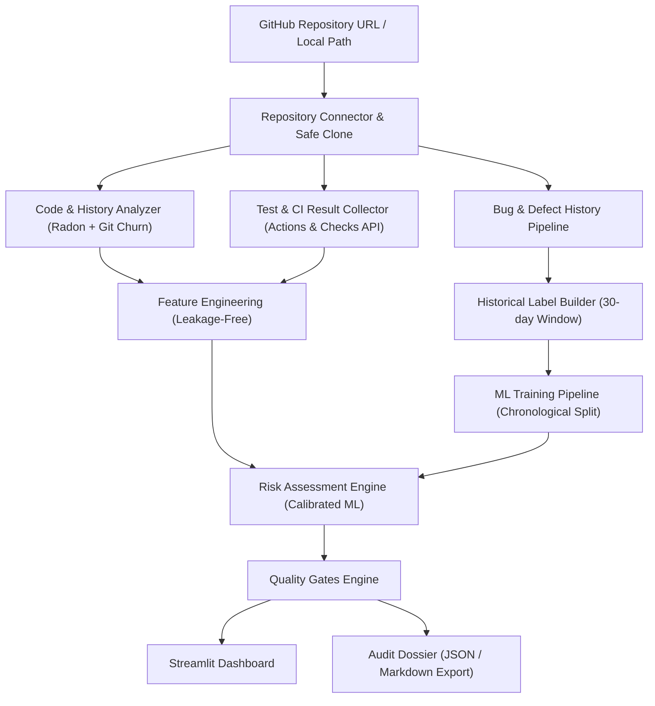

# Software Release Risk Predictor (RRP)

[](https://python.org)
[](tests/)
[](app.py)
[](LICENSE)

An AI-assisted Software Verification & Validation (V&V) system designed to assess software release readiness. It inspects Git repositories, calculates static Radon code metrics, aggregates CI/test evidence, estimates calibrated defect risks using machine learning, and evaluates explicit release quality gates.

---

## 🏗️ System Architecture



### Dual-Mechanism Verification
1. **Mechanism A: Rule-Based Quality Gates (Deterministic)**
   - Analysis completeness check (blocks assessment if code metrics failed).
   - Test execution verification (passes only if tests explicitly succeed; missing evidence marked `UNKNOWN`).
   - CI workflow checks (GitHub Actions & Check-Runs).
   - Complexity & churn thresholds (warns if churn > 5,000 lines or complexity > 40).
   - **Crucial V&V rule:** Outputs `NO_BLOCKING_FINDINGS` or `REVIEW_REQUIRED`, **never** `SAFE_TO_RELEASE`.

2. **Mechanism B: Machine Learning Defect-Risk Predictor (Probabilistic)**
   - Estimates the likelihood that a proposed release will have a qualifying defect within 30 days.
   - Enforces an **Applicability Gate**: if input features or repository language fall outside the validated scope (e.g. non-Python or missing complexity metrics), the model displays *"ML risk estimate unavailable"* rather than hallucinating a probability.
   - Provides transparent contributing explanation factors (Step 22).

---

## 💻 Hardware Efficiency & PC Specs

This project is built from the ground up for high performance on laptop hardware:
- **Target Specs:** AMD Ryzen 5 5500U (6 Cores / 12 Threads) with 16GB 3200MHz RAM.
- **Resource Footprint:**
  - Full model training with chronological validation finishes in **under 2.5 seconds**.
  - Local repository metric extraction and gate evaluation completes in **~1.5 seconds**.
  - Peak memory usage during training: **< 250 MB** (well within 16GB RAM).
  - No dedicated GPU is required; all scikit-learn models run multi-threaded on CPU.

---

## 🚀 Quickstart Guide

### 1. Development Environment Setup
```bash
# Clone or enter the project directory
cd ~/projects/software-rrp

# Activate virtual environment
source .venv/bin/activate

# Install dependencies (already completed)
pip install -r requirements.txt
```

### 2. Optional: Configure GitHub API Token
To prevent GitHub API rate-limiting (60 requests/hour unauthenticated vs. 5,000 requests/hour authenticated), create a `.env` file:
```bash
cp .env.example .env
# Edit .env and paste your GitHub personal access token:
# GITHUB_TOKEN=ghp_your_token_here
```

### 3. Run the Automated Verification Suite
Verify all 28 automated V&V unit and integration tests:
```bash
pytest -v
```

### 4. Retrain or Validate the Machine Learning Model
```bash
python -m src.train
```

### 5. Launch the Streamlit Dashboard
```bash
streamlit run app.py
```
Open your browser at `http://localhost:8501`.

---

## 📂 Project Structure

```
software-rrp/
├── .venv/                      # Python virtual environment
├── src/                        # Core application modules
│   ├── github_connector.py     # GitHub URL validation and REST API client
│   ├── git_analyzer.py         # Subprocess-safe Git history and churn extractor
│   ├── code_metrics.py         # Radon AST, Cyclomatic Complexity & Maintainability Index
│   ├── ci_collector.py         # GitHub Actions workflows & Check-Runs aggregator
│   ├── defect_labeling.py      # 30-day post-release defect attribution (leak-free)
│   ├── preprocessing.py        # Chronological train/val/test splitter and standard scaler
│   ├── train.py                # Model training, candidate selection, artifact persistence
│   ├── evaluate.py             # Precision, Recall, F1, PR-AUC, Brier score, regression gate
│   ├── predict.py              # Calibrated inference, scope validation, explainability
│   ├── quality_gates.py        # Release quality gate engine (NO_BLOCKING_FINDINGS)
│   ├── report_generator.py     # JSON and Markdown audit dossier generator
│   └── pipeline.py             # Unified end-to-end assessment pipeline
├── data/
│   ├── raw/                    # Raw historical commit records
│   ├── processed/              # Cleaned training dataset
│   └── dataset_card.md         # Documented dataset card and labeling methodology
├── models/
│   ├── release_risk_model.joblib # Serialized model + preprocessor bundle
│   └── model_metadata.json     # Model version, algorithm, metrics, feature importances
├── reports/
│   └── model_evaluation_report.json # Holdout evaluation benchmark dossier
├── tests/                      # Automated test suite (28 tests)
│   ├── test_github_connector.py
│   ├── test_git_analyzer.py
│   ├── test_code_metrics.py
│   ├── test_quality_gates.py
│   ├── test_ml_pipeline.py
│   └── test_end_to_end.py
├── app.py                      # Interactive Streamlit dashboard
├── requirements.txt            # Project dependencies
├── pytest.ini                  # Pytest configuration
├── .gitignore                  # Git ignore rules
└── README.md                   # This documentation
```

---

## 🛡️ Release Quality Gates Reference

| Gate Name | Condition | Status | Description |
|---|---|---|---|
| **Analysis Completeness** | Code analysis failed | `BLOCKED` | Halts assessment; cannot evaluate without valid AST metrics |
| **Test Verification** | Test failure observed | `FAIL` | Halts release; one or more tests failed in commit |
| **Test Verification** | No test results published | `UNKNOWN` | Missing evidence is not assumed to be safe |
| **CI Workflow** | Workflow failed | `FAIL` | GitHub Actions check failure detected |
| **Code Churn Gate** | Churn > 5,000 lines | `WARN` | Highlights unusually high change volume |
| **Complexity Gate** | Max Complexity > 40 | `WARN` | Flags extreme branching density |
| **ML Defect Risk** | Predicted Risk $\ge$ 70% | `REVIEW_REQUIRED` | Model flags high statistical defect likelihood |
| **ML Defect Risk** | Scope Inapplicable | `NOT_APPLICABLE` | Out-of-domain repository (no hallucinated probability) |

---

## 📜 Verification & Validation Compliance Notice
> **Important:** This system adheres to strict software verification principles:
> 1. Automated checks can prove the presence of issues, but never their complete absence.
> 2. The status `NO_BLOCKING_FINDINGS` indicates that all evaluated quality checks passed without known failures; it is **not** a guarantee that the software is bug-free.
> 3. Machine learning risk estimates are empirical indicators intended to prioritize code review, not formal guarantees of code correctness.
