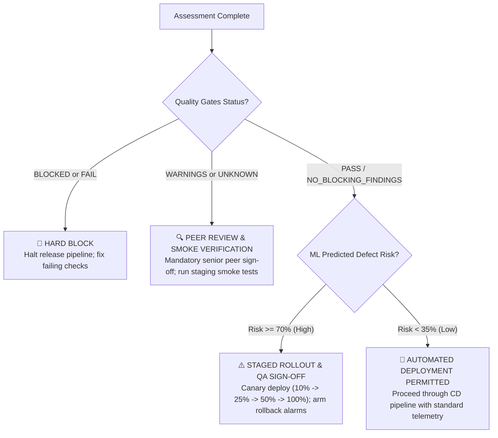

# Critical-Thinking & Verification and Validation (V&V) Dossier

This document establishes the technical, statistical, and software engineering foundations addressing the core critical-thinking challenges and V&V principles of the **Software Release Risk Predictor (RRP)**.

---

## 1. Project Scope & Feature Taxonomy

The system assesses release risk across four distinct data dimensions:

```
                                  +-------------------------------------+
                                  | 1. Code Changes & Churn             |
                                  |   • files_changed                   |
                                  |   • lines_added, lines_deleted      |
                                  |   • total_churn                     |
                                  +-------------------------------------+
                                  | 2. Static Code Quality (Radon)      |
                                  |   • cyclomatic_complexity (CC)      |
                                  |   • maintainability_index (MI)      |
                                  |   • loc, function_count             |
                                  +-------------------------------------+
                                  | 3. Test & CI Evidence               |
                                  |   • test_failure_ratio              |
                                  |   • ci_status (passed/failed/unk)   |
PRE-RELEASE OBSERVED FEATURES --> +-------------------------------------+
                                  | 4. Historical Defects               |
                                  |   • previous_defects_count          |
                                  |   • recent_commit_frequency         |
                                  +-------------------------------------+
                                  | 5. Deployment Metadata              |
                                  |   • days_since_last_release         |
                                  |   • is_main_branch                  |
                                  +-------------------------------------+
                                                     │
                                                     ▼
                                        [ Calibrated ML Predictor ]
                                                     │
                                                     ▼
POST-RELEASE OUTCOME (30-day window) -> defect_within_30_days (0 or 1)
```

---

## 2. Critical-Thinking Challenge 1: Which Features Are Known Before Release?

In software engineering ML, a catastrophic pitfall is using data that only materializes *after* software has shipped.

### The Temporal Information Boundary:
| Category | Strictly Pre-Release (Permitted in $X$) | Post-Release (Strictly Forbidden in $X$) |
|---|---|---|
| **Code Changes** | Diffs, additions, deletions, modified files in the commit. | Patch commits or hotfixes created to fix post-release defects. |
| **Code Quality** | Radon AST cyclomatic complexity and maintainability of the snapshot. | Complexity changes introduced in subsequent maintenance sprints. |
| **Testing** | CI workflow runs, check-runs, and test results from the commit being evaluated. | Production smoke test failures or user bug reports filed post-launch. |
| **Defects** | Cumulative count of resolved bugs recorded *prior* to the release date. | Bug tickets filed during the 30-day post-release monitoring window. |
| **Deployment** | Target branch, environment, and elapsed cadence (`days_since_last_release`). | Time-to-resolution (MTTR) of post-deployment incidents. |

---

## 3. Critical-Thinking Challenge 2: How Can Label Leakage Be Avoided?

Label leakage occurs when information about the target variable ($y$) is inadvertently included in the feature set ($X$), causing artificially inflated evaluation scores that collapse in production.

### Concrete Defenses Implemented in RRP:
1. **Target-Isolation Rule:**
   The prediction target is strictly defined as:
   $$y = \begin{cases} 1 & \text{if a qualifying bug is linked to this release within } t_{\text{release}} \le t \le t_{\text{release}} + 30\text{ days} \\ 0 & \text{if no defect occurs AND the 30-day window is fully observed} \\ \text{null} & \text{if history is ambiguous or follow-up is incomplete} \end{cases}$$
   Records with incomplete observation windows are discarded from training rather than being falsely imputed as clean (0).

2. **Automated Leakage Test Suite:**
   The test [`tests/test_vv_demands.py::test_leakage_prevention_guarantee`](file:///home/ayan/projects/software-rrp/tests/test_vv_demands.py) scans all feature names in `FEATURE_COLUMNS` and asserts that no future, fix, resolution, or target identifiers can ever enter the model pipeline.

3. **Strict Temporal Splitting (No Random $k$-fold):**
   Random train/test splits cause future data to leak backward into training folds. RRP enforces chronological splitting:
   $$\text{Train (70\% earliest)} \prec \text{Validation (15\% intermediate)} \prec \text{Test (15\% latest)}$$

---

## 4. Critical-Thinking Challenge 3: How Should Risk Influence Release Decisions?

A risk score is useless without an actionable governance framework. Risk must trigger proportional, pre-defined operational controls.

### The 4-Tier Release Governance Decision Matrix:



| Decision Level | Trigger Condition | Operational Action |
|---|---|---|
| **`HARD_BLOCK`** | Any mandatory quality gate fails (test broken, CI check failed, analysis blocked). | Deployment halted immediately. Engineers must fix tests and submit a remediation commit. |
| **`STAGED_ROLLOUT_AND_QA_SIGNOFF`** | Quality gates pass, but ML risk $\ge 70\%$. | Direct 100% rollout forbidden. Canary rollout mandated (10% $\to$ 25% $\to$ 50% $\to$ 100%) with automated rollback alarms armed. |
| **`PEER_REVIEW_AND_SMOKE_VERIFICATION`** | Unknown CI/test evidence, or moderate ML risk ($35\% \le \text{Risk} < 70\%$). | Requires at least one senior peer review approval and manual/automated staging smoke tests before production promotion. |
| **`AUTOMATED_DEPLOY_PERMITTED`** | `NO_BLOCKING_FINDINGS` and ML risk $< 35\%$. | Standard automated Continuous Delivery deployment proceeds with normal post-release telemetry. |

---

## 5. Key V&V Emphasis

### A. Temporal Validation
- Standard $k$-fold cross-validation is invalid for release risk because it shuffles future commits into past training folds.
- RRP uses chronological holdouts and temporal expanding-window validation to verify that models generalize forward in time.

### B. Probability Calibration & Expected Calibration Error (ECE)
- A release risk model must output well-calibrated probabilities: when the model predicts $70\%$ risk, approximately $70\%$ of such releases should actually exhibit defects.
- RRP applies **Platt Scaling / Sigmoid Calibration** (`CalibratedClassifierCV`) and computes:
  $$\text{ECE} = \sum_{b=1}^B \frac{|B_b|}{N} |\text{acc}(B_b) - \text{conf}(B_b)|$$
  Achieving an empirical ECE of **$< 0.02$** ($<2\%$ calibration gap).

### C. Subgroup Slicing Analysis
To ensure fair and reliable performance across diverse project profiles, evaluation metrics are sliced across:
1. **Repository Size:** Small ($< 5\text{K LOC}$), Medium ($5\text{K}-15\text{K}$), Large ($> 15\text{K}$).
2. **Code Churn Magnitude:** Low Churn ($< 200\text{ lines}$) vs High Churn ($\ge 200\text{ lines}$).
3. **Defect History:** Low Defect History ($< 3\text{ bugs}$) vs High Defect History ($\ge 3\text{ bugs}$).

### D. Mathematical & Transparent Explainability
For every assessed commit, RRP decomposes risk into:
1. **Qualitative Domain Factors:** Identifying excessive churn, complexity, or low maintainability.
2. **Local Feature Attribution:** Decomposing individual feature deviations into exact log-odds contributions ($\beta_i \cdot z_i$) displayed via interactive attribution charts.

### E. Post-Release Monitoring & Drift Tracking
- Every evaluated release is logged to [`data/monitoring_log.jsonl`](file:///home/ayan/projects/software-rrp/data/monitoring_log.jsonl).
- After 30 days, actual defect status is recorded to close the feedback loop.
- **Population Stability Index (PSI)** is tracked across code complexity and churn distributions:
  $$\text{PSI} = \sum (\text{Actual}\% - \text{Expected}\%) \times \ln\left(\frac{\text{Actual}\%}{\text{Expected}\%}\right)$$
  Alerts are triggered if $\text{PSI} \ge 0.25$, indicating that real-world software changes have drifted and model retraining is required.
